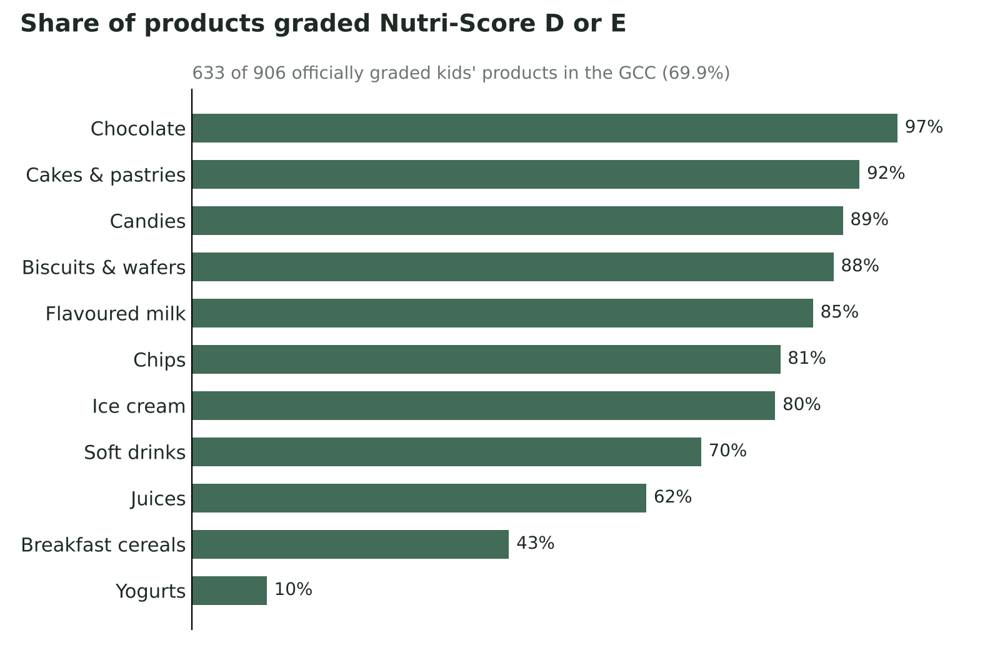
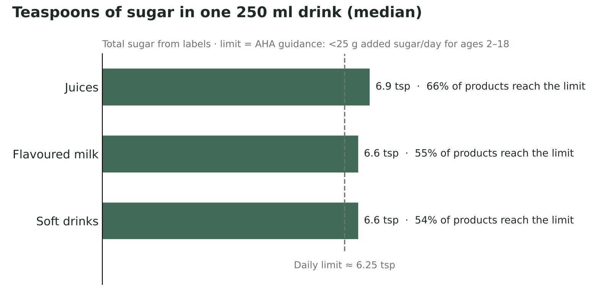

# 🧃 Kids Food Swap — Nutrition Analytics & Healthier Alternatives

**بدّلها لطفلي** · An end-to-end data project on the snacks and drinks children eat in the Gulf (GCC) market:
how healthy they really are, how much sugar they contain, and which healthier product from the same shelf could replace them.

Built with **PySpark · Spark SQL · Pandas** on Google Colab, using open data from [Open Food Facts](https://world.openfoodfacts.org/).

[](https://colab.research.google.com/github/zomrd/kids-food-swap/blob/main/notebooks/01_data_collection_cleaning.ipynb)
[](https://colab.research.google.com/github/zomrd/kids-food-swap/blob/main/notebooks/02_analytics_swaps.ipynb)

---

## Key findings

| | |
|---|---|
| **7 in 10** | officially graded products are Nutri-Score **D or E** (633 of 906) |
| **6.9 tsp** | median sugar in one 250 ml juice — above a child's daily limit (≈ 6.25 tsp) |
| **66%** | of juices reach that daily limit in a single 250 ml serving |
| **97% vs 10%** | chocolate is the worst category, yogurts the best |
| **368** | products got a healthier same-type alternative, saving **4.4 tsp** of sugar per 100 g on average |





---

## Pipeline

```
Open Food Facts (full dump, millions of products)
   │  PySpark: filter Gulf countries
   ▼
Bronze ── raw Gulf products (Parquet)
   │  data quality report · type casting · cleaning · de-duplication
   ▼
Silver ── clean products
   │  rule-based classification into 12 kids' food groups · outlier handling
   ▼
Gold ──── 1,083 kids' products (Parquet + CSV)
   │  Spark SQL analytics · swap recommender · automated tests
   ▼
Results ─ CSV reports + swap recommendations
```

### Notebook 1 — Data collection, quality & cleaning
- Reads the full Open Food Facts dump with **PySpark** and keeps products sold in Saudi Arabia, UAE, Kuwait, Qatar, Bahrain and Oman.
- **Medallion architecture** (Bronze → Silver → Gold), with a smart re-run that skips the heavy download when Bronze already exists.
- **Data quality report** before any cleaning, and a row count logged at every cleaning step.
- **Rule-based classification** into 12 groups (juices, chocolate, chips, yogurts, baby food…) using exact tag matching, ordered rules and exclusion lists.
- **Measured accuracy**: rules were tuned on two development samples (247 products), then tested once on a **held-out sample of 123 products** never seen during tuning → **91.9% accuracy**.
- Salt outliers (> 5 g / 100 g) treated as data-entry errors.
- Automated data tests before saving to Gold.

### Notebook 2 — Analytics & swap recommender
- **Spark SQL** analysis: Nutri-Score distribution per group, top brands, top 3 sugariest products per group (**window functions**), and teaspoons of sugar per 250 ml drink.
- **Swap recommender** (rule-based, explainable — no ML). For each product it looks for an alternative that is:
  1. in the **same food group**,
  2. **better Nutri-Score**,
  3. at least **30% less sugar**,
  4. **similar in type** — Jaccard similarity on each product's *distinctive* category tags (tags shared by > 60% of the group are removed).

  Candidates are ranked by similarity, then by sugar saved. An alternative can be suggested **at most 5 times** to keep results diverse.
- **Automated tests** on the data and on every recommender rule; results are only saved if all tests pass.

---

## The recommender: v1 vs v2

The first version simply picked the alternative that saved the most sugar. It looked good on paper — until the same biscuit was suggested for 125 different products.

| | v1: max sugar saved | v2: similarity + diversity |
|---|---|---|
| Products with an alternative | 811 (89.5%) | 368 (40.6%) |
| Unique alternatives | 70 | **222** |
| Max times one alternative is reused | 125 | **5** |
| Avg. type similarity (top pick) | 0.13 | **0.54** |
| Avg. sugar saved (tsp / 100 g) | 4.9 | 4.4 |

**v2 was chosen**: fewer products are covered, but the suggestions are relevant (same type of product) and varied — a precision-over-coverage trade-off.

Example: **Nutella Hazelnut Spread** (E, 56.3 g sugar) → **Keto Choc Nut Spread** (C, 2.3 g) — 13.5 teaspoons less sugar per 100 g.

---

## Repository structure

```
kids-food-swap/
├── notebooks/
│   ├── 01_data_collection_cleaning.ipynb   # PySpark ingestion, quality, cleaning, classification
│   └── 02_analytics_swaps.ipynb            # Spark SQL analytics, recommender, tests
├── results/
│   ├── grade_d_e_by_group.csv
│   ├── sugar_in_drinks.csv
│   ├── recommender_v1_vs_v2.csv
│   └── swap_recommendations.csv            # 864 suggestions for 368 products
├── images/                                 # charts used in this README
├── requirements.txt
├── LICENSE
└── README.md
```

> The notebooks are documented in **Arabic**, cell by cell.

## How to run

1. Open **Notebook 1** in Google Colab (badge above) and run all cells. It downloads the Open Food Facts dump (~1 GB compressed) to your Google Drive. The first run takes ~20 minutes, later runs about one minute.
2. Open **Notebook 2** and run all cells (~2 minutes).

Outputs are written to `MyDrive/kids_food_swap/` (`gold/` and `reports/`). To run locally instead, install `requirements.txt` and replace the Google Drive paths.

---

## Limitations

- Labels report **total sugar**, not added sugar, so teaspoon figures are approximate; drink servings assume **250 ml**.
- Only the **official Nutri-Score** is used — products without one are left ungraded rather than guessed. Nutri-Score does not apply to baby food.
- Open Food Facts is crowd-sourced: some products list **0 g sugar** where the label likely says otherwise (e.g. some biscuits). Most 0 g alternatives are genuinely sugar-free (zero drinks, keto products, plain oats), but a few are data-entry errors.
- The recommender knows nothing about **taste, price or availability** in stores.

## Next steps

- Flag suspicious nutrition values (e.g. 0 g sugar in biscuits) before recommending.
- Add prices, to suggest a healthier alternative at a similar price.
- Schedule a periodic refresh from Open Food Facts.

---

## Data & license

- Data: © [Open Food Facts](https://world.openfoodfacts.org/) contributors, available under the [Open Database License (ODbL)](https://opendatacommons.org/licenses/odbl/1-0/). The CSV files in `results/` are derived from it and shared under the same license.
- Code: MIT License.

## Author

**Zomrod Al Shihab** — Computer Science graduate · Microsoft Certified: Power BI Data Analyst (PL-300)
[LinkedIn](https://www.linkedin.com/in/zomored-al-shihab) · [GitHub](https://github.com/zomrd)
